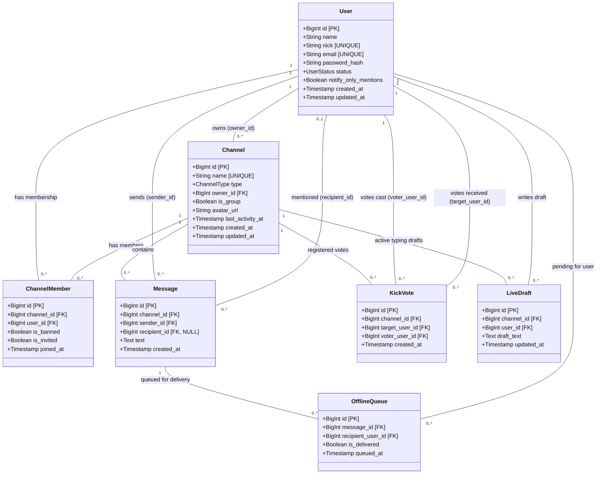

# Návrh logického dátového modelu (UML Class Diagram)

Tento dátový model reprezentuje relačnú databázu pre semestrálnu prácu **Send light** (IRC / Slack štýl chatovacej aplikácie) podľa všetkých bodov zadania.

## 1. UML Class Diagram v Mermaid notácii

---

## 2. Pokrytie požiadaviek zadania v modeli

1. **Používateľ (`User`)**:
   - `name`: Meno a priezvisko (bod 26)
   - `nick`: Unikátna prezývka pre @adresovanie a príkazy (bod 26, 41)
   - `email`: Unikátny email na prihlasovanie
   - `status`: Online, Away, DND, Offline (body 52–55)
   - `notify_only_mentions`: Nastavenie notifikácií iba pre adresované správy (bod 51)

2. **Kanály (`Channel`)**:
   - `name`: Unikátny názov kanála (bod 41)
   - `type`: `public` alebo `private` (bod 31)
   - `owner_id`: Správca kanála, ktorý ho vytvoril (bod 32)
   - `last_activity_at`: Dátum a čas poslednej pridanej správy; kanál po 30 dňoch inaktivity zaniká a názov sa uvoľní (bod 33)

3. **Členstvo a pozvánky (`ChannelMember`)**:
   - `is_invited`: Indikátor pozvánky – topovanie a zvýraznenie v UI (bod 29)
   - `is_banned`: Permanentný ban po 3 kick-hlasoch alebo vyhodení správcom (bod 40)

4. **Správy a adresovanie (`Message`)**:
   - `sender_id`: Autor správy
   - `recipient_id`: Voliteľný cudzí kľúč pri adresovaní konkrétnemu používateľovi cez `@nickname` (body 44–45)
   - `text`: Text správy

5. **Hlasovanie o vyhodení (`KickVote`)**:
   - Uchováva hlasy členov verejného kanála (`/kick nick`). Pri dosiahnutí 3 hlasov sa používateľovi nastaví trvalý ban (bod 40).

6. **Offline fronta (`OfflineQueue`)**:
   - Uchováva správy doručené v čase, keď bol príjemca v stave Offline (bod 55). Po prechode do Online sa správy doručia.

7. **Živé rozpísané správy (`LiveDraft`)**:
   - Podpora pre real-time náhľad textu rozpísanej správy pred odoslaním (body 57–58).

---

## 3. Ako vyexportovať JPG pre odovzdanie do AISu:

1. Otvorte stránku **[https://mermaid.live](https://mermaid.live)**.
2. Do ľavého okna vložte kód z bloku `mermaid` vyššie.
3. Vpravo dole kliknite na **Actions -> Download JPEG (alebo PNG)**.
4. Uložte súbor ako `uml_data_model.jpg` a priložte ho do odovzdávaného ZIP archívu.
